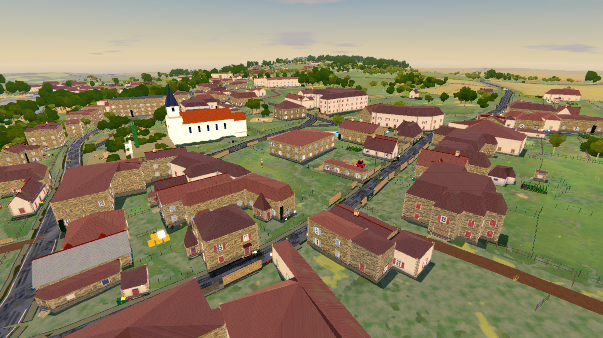
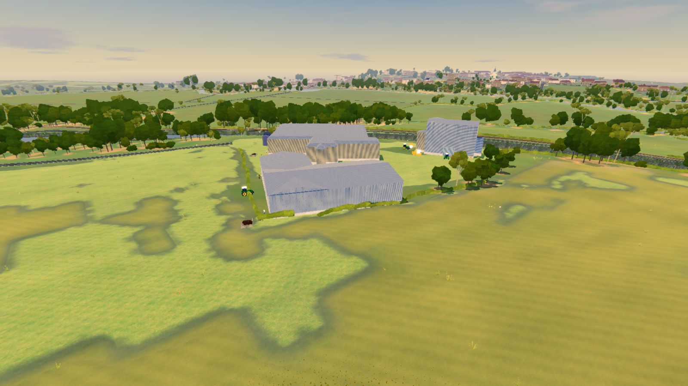
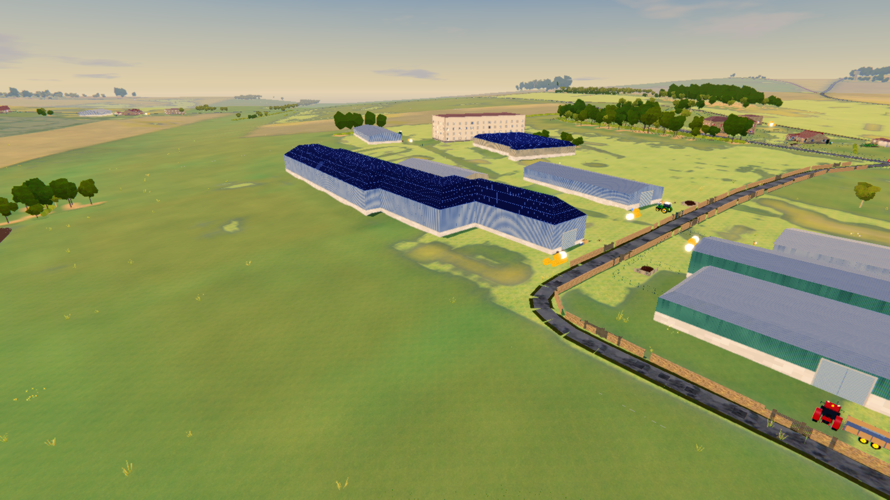
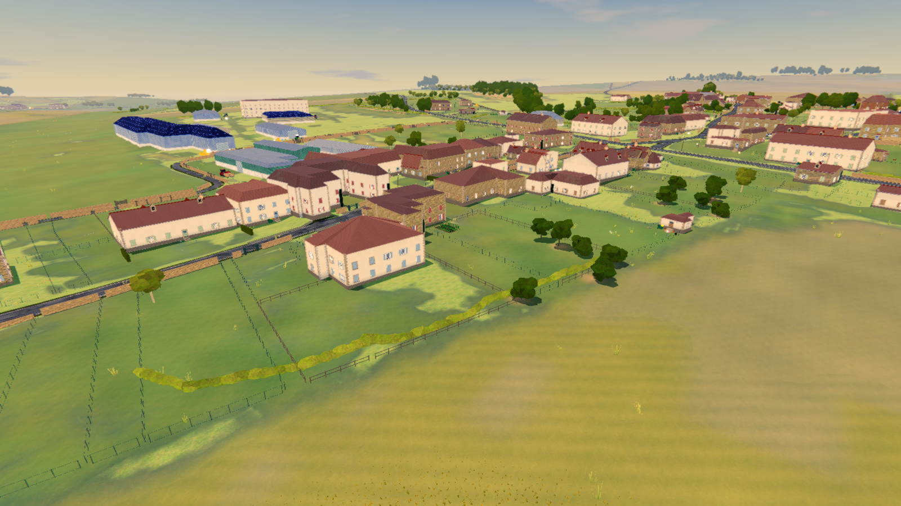
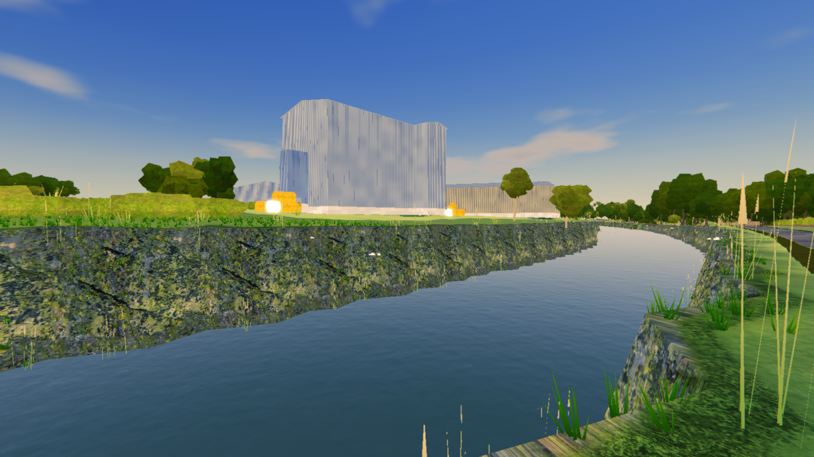
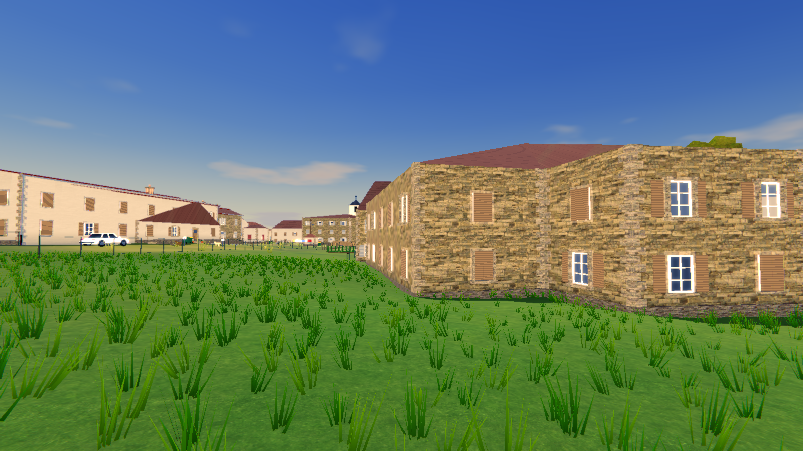
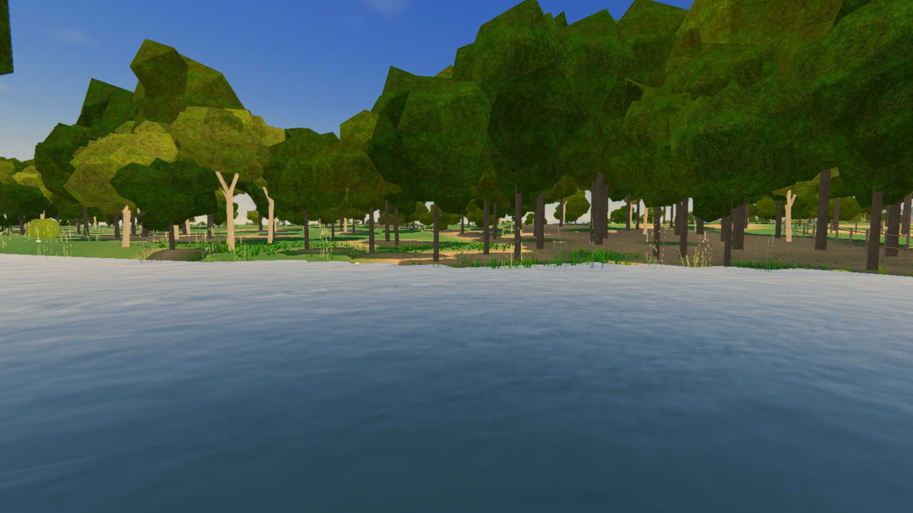
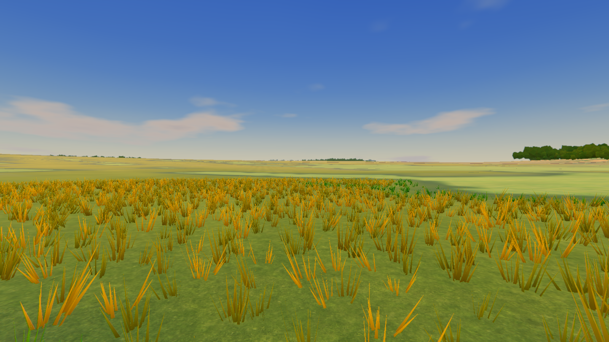

# Terre Brûlée

FPS tactique Seconde Guerre mondiale (Unity), fait par Paul avec Claude.
Bots en équipe, plusieurs factions et classes, armurerie, véhicules, et des cartes construites à partir de **vrais lieux** —
dont **Montigny-Mornay-Villeneuve-sur-Vingeanne** (Côte-d'Or) reconstitué d'après les données de l'IGN : relief au mètre,
bâtiments à leur emplacement et à leur hauteur réels, routes, ponts, rivière, canal, **hangars agricoles et coopérative céréalière**.

## Jouer (Windows 64 bits)

1. Télécharger **TerreBrulee-Windows-v1.7.34.zip** dans [Releases](../../releases/latest).
2. Décompresser, lancer `TerreBrulee/TerreBrulee.exe`.

Version **1.7.34** (le jeu l'affiche en interne comme « 10.35 »).

## Images

| | |
|---|---|
|  |  |
|  |  |
|  |  |

## Nouveau en 1.7.34

- **Hangars agricoles et coopérative** (d'après la BD TOPO de l'IGN) : 33 hangars en bardage de tôle, toit de tôle à faible pente et portail
  coulissant, 8 tours et cellules de silo, silos ronds galvanisés ; la **coopérative Dijon Céréales** (deux grands hangars et sa tour de
  manutention, au bord du canal) et l'exploitation de Mornay avec ses **deux toits à panneaux solaires**. Ils étaient montés comme des granges de village.
- **Moins de saccades** : début de partie lissé (le monde se construit pendant qu'on joue), creusage de la terre en **Rust** (module natif,
  résultat identique à l'ancien code), cloches et menu de construction sans à-coups, véhicules garés endormis, explosions
  beaucoup moins saccadées (un souffle de 32 kg : 577 → 181 ms).
- **Plus beau** : prairies vertes sous l'herbe, herbe en plaques, feuillage éclairé à contre-jour et sans stries, sous-bois à litière brune,
  façades vieillies (humidité au pied, taches), pierre calcaire moins orange, grillages enfin transparents, gouttières en zinc patiné.
- **Vie** : papillons dans les prés, libellules au-dessus de l'eau, réglage du **volume des oiseaux**, silhouettes d'habitants réparées au loin.
- **Véhicules** : tous franchissent bordures et murets (camions, chars, tracteurs), chars qui couchent les arbres au pas, frein à main
  (Espace) pour le drift, mode réaliste ou arcade, eau vivante.
- **Outils et armes** : pelle 3D, TNT, détonateur et pistolet de réparation, ceinture 1-9 à la Minecraft, inspection de l'arme (R),
  10 armes modélisées avec pièces mobiles, sons de tir refaits à partir de vrais enregistrements libres de droits.
- **Habitants, grades et livre créatif** (touche N) : habitants des villages, grades au mérite, icônes 3D de tous les objets.

Limite connue : les hangars agricoles ont des murs pleins (on ne peut pas y entrer).

## Sources des données

Relief, bâti, routes et photo aérienne : IGN (licence ouverte Etalab 2.0) · Cadastre (Etalab) · © contributeurs OpenStreetMap (ODbL) ·
textures Poly Haven (CC0) · musique MusicGen (CC-BY-NC 4.0) · bruitages BBC Sound Effects (licence RemArc, usage personnel et non commercial). Jeu gratuit, non commercial.

Voir [LICENSE](LICENSE) : tous droits réservés, copie et décompilation interdites.
